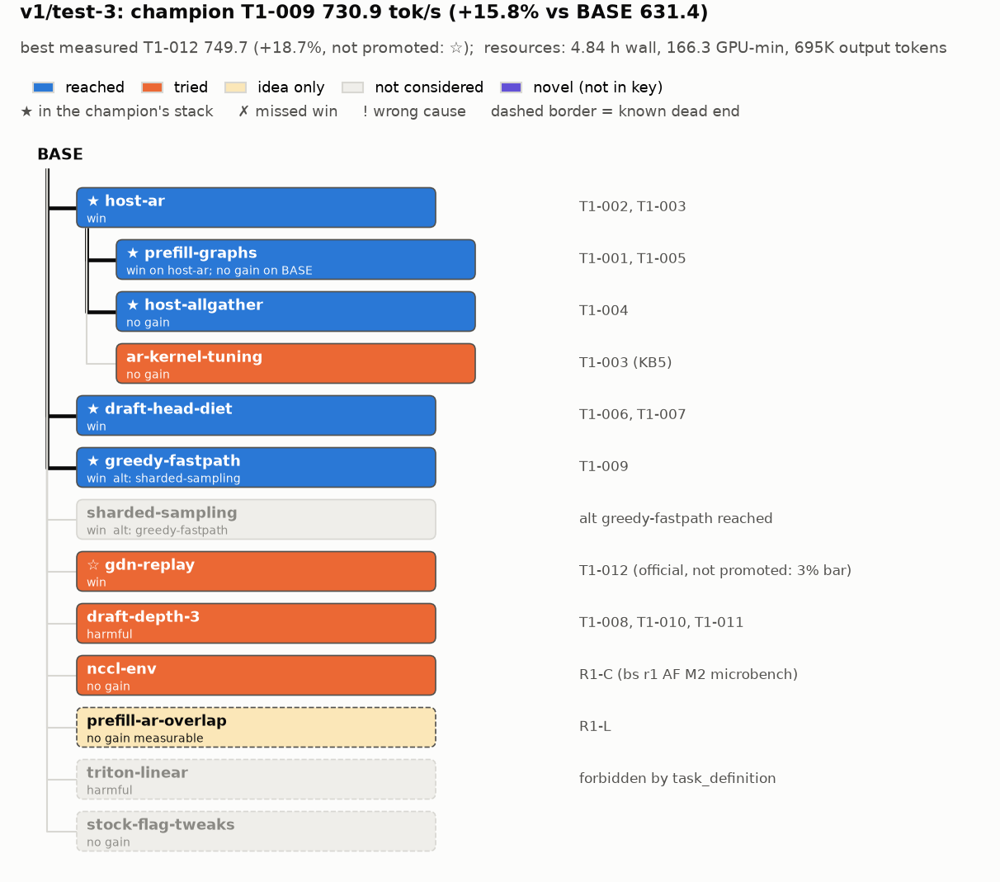

# Judge b: v1/test-3

## Resources
`python3 .claude/skills/eval-run/resources.py flavors/v1/runs/test-3`:
```
agent                            role           msgs    input  cache_wr  cache_rd   output  hours  model
bs-r1-adjacent_field             brainstormer     38       0K      130K     3.12M      49K  0.34  claude-opus-5-5
bs-r1-systematic_engineer        brainstormer     37       0K      135K     3.19M      55K  0.18  claude-opus-5-5
bs-r2-adjacent_field             brainstormer     34       0K      124K     2.87M      48K  0.16  claude-opus-5-5
bs-r2-systematic_engineer        brainstormer     34       0K      136K     3.07M      47K  0.16  claude-opus-5-5
bs-r3-adjacent_field             brainstormer     19       0K       81K     1.09M      25K  0.08  claude-opus-5-5
bs-r3-systematic_engineer        brainstormer     36       0K      111K     2.66M      32K  0.1   claude-opus-5-5
leader-1.w1                      worker            8       0K       32K      222K       5K  0.1   claude-sonnet-5-5
leader-1.w2                      worker           60       0K      143K     5.35M      67K  1.03  claude-sonnet-5-5
leader-1.w3                      worker           24       0K       54K      991K      10K  0.47  claude-sonnet-5-5
leader-1.w4                      worker           63       0K      143K     6.47M      44K  0.96  claude-sonnet-5-5
leader-1.w5                      worker           21       0K       56K      947K      11K  0.25  claude-sonnet-5-5
leader-1.w6                      worker           69       0K      236K    10.31M     127K  0.95  claude-sonnet-5-5
leader-1                         leader          111       0K      223K    14.68M      87K  3.51  claude-opus-5-5
manager                          manager          94       0K      178K    12.51M      88K  4.84  claude-opus-5-5
Per role: ALL output 695K (brainstormer 256K, leader 87K, manager 88K, worker 264K); cache_rd 67.5M
Wall clock (registered agents' start/stop): 2026-11-06T22:46:46 -> 2026-11-07T03:37:27, 4.84 h
GPU-minutes (gpu/ledger.jsonl): brainstorm/uncharged 13.2, official 55.0, unofficial 108.8, total 177.0
  r1: brainstorm 11.8, official 18.6, unofficial 28.1 | r2: 1.1 / 10.1 / 54.8 | r3: 0.3 / 10.0 (+10.7 team "-") / 25.9 | None: 5.7
```
Notes:
- The 10.7 GPU-min "round 3, team -" official is job 48, `official:BASE` run by **the human** at
  03:37-03:48, after the run stopped (journal.md:19, gpu/ledger.jsonl job 48). Run's own GPU use =
  177.0 - 10.7 = **166.3 GPU-min**. The run stopped at 03:08 (journal.md:19); the 4.84 h wall clock
  includes the manager's post-stop note (journal.md:20).
- Nothing missing: all 14 agents found with transcripts.

## Config and outcome
- Flavor v1; 1 leader (T1), max 2 workers, max 5 rounds, 80 GPU-min/team/round, brainstormers
  systematic_engineer + adjacent_field; manager/leader/brainstormers Opus 5.5, workers Sonnet 5.5
  (config.md). Task qwen38-27b-fp8-2x4090, focus = whole-engine c=16 tok/s (focus.md).
- Promotion bar: < 3% is noise (task_definition.md:4-5).
- BASE official 631.4 (bank/BASE/record.md; a human re-run after the run gave 635.9).
- **Champion (official): T1-009, 730.9 tok/s, +15.8%** (champion.md). **Best measured: T1-012, 749.7,
  +18.7%** (+2.6% vs T1-009), not promoted because of the 3% bar (reports/r3.md:19).
- Curve (champion vs cumulative GPU-min from the ledger, by job end):

  | after | GPU-min | champion | tok/s | vs BASE |
  |---|---|---|---|---|
  | start | 5.7 | BASE | 631.4 | 0 |
  | round 1 (00:42) | 64.2 | T1-005 | 699.2 | +10.7% |
  | round 2 (02:03) | 130.1 | T1-009 | 730.9 | +15.8% |
  | round 3 (03:08) | 166.3 | T1-009 (best measured T1-012 749.7) | 730.9 | +15.8% (+18.7%) |
- Human decisions (context, not agent choices): round-1 direction approved by the human
  (journal.md:6); rulings 1-3 (task_definition.md:52-59); GPU 0 clock lock accepted (journal.md:12);
  correctness rule (journal.md:13); tree format (journal.md:16); **stop after round 3 of 5**
  (journal.md:18). Unused budget per round: 33.4 (journal.md:9), 15.1 (reports/r2.md:9), 44.1
  (reports/r3.md:16) GPU-min.

## Overlay graph


Graded against the key as revised on 2026-11-07: 13 measured nodes only; untested and estimate-only
ideas moved to `answer_keys/qwen38-27b-fp8-2x4090/ideas.md` and are not graded. The hollow star on
`gdn-replay` marks the best measured stack (T1-012), which is not the official champion (T1-009).

```
BASE
├─ host-ar  [reached, as expected]                       T1-002
│  ├─ prefill-graphs  [reached, as expected]             T1-001 (BASE, noise) -> T1-005
│  ├─ host-allgather  [reached, as expected]             T1-004
│  └─ ar-kernel-tuning  [tried (component), as expected] T1-003 / KB5
├─ draft-head-diet  [reached, as expected]               T1-006, T1-007
├─ greedy-fastpath  [reached, as expected]               T1-009
├─ sharded-sampling  [not-considered, -; alt greedy-fastpath reached]
├─ gdn-replay  [tried: official +2.6%, not promoted under the 3% rule; as expected]  T1-012
├─ draft-depth-3  [tried, as expected (cause found in r3)] T1-008, T1-010, T1-011
├─ nccl-env  [tried (component, brainstormer), as expected]
├─ prefill-ar-overlap  [idea-only, -]                    R1-L
├─ triton-linear  [not-considered: forbidden by task_definition, -]
└─ stock-flag-tweaks  [not-considered, -]
```

## Overlay
Unmeasured run ideas that match `ideas.md` entries are not graded. None of them was measured in this
run, so none moves into the key (see Key updates).

| node | contact | base | run's result and cause | verdict | evidence |
|---|---|---|---|---|---|
| host-ar | reached | BASE | +5.0% official (662.8); decode AR 60.8 -> 49.6 us, all gain in decode; bitwise == NCCL | as expected | bank/T1-002/record.md; T1-003; KB2 |
| prefill-graphs | reached | BASE, then host-ar + host-allgather | on BASE +2.2% unofficial, noise, "GPU-bound" (T1-001, KB1); on host-ar +4.8% / official 699.2, cause "cuts launch-induced skew", not separated (KB4) | as expected (the run re-tried it on host-ar on its own, the key's grading point) | bank/T1-001, bank/T1-005; shared_kb.md:3,6 |
| host-allgather | reached | host-ar | ~0 unofficial (666.8 vs 665.0); ~1% est, kept as exact building block | as expected | bank/T1-004; KB6 |
| ar-kernel-tuning | tried (component) | host-ar | chunk pipelining at M=48: K=2..8 slower (54-85 vs 51-53 us), fences ~5 us each; "near floor" | as expected | bank/T1-003 results (b); KB5 |
| draft-head-diet | reached | host-ar + prefill-graphs | local argmax +1.1% (T1-006), + fp8 draft head +3.0% same-job (T1-007), acceptance 2.343 vs 2.340 | as expected | bank/T1-006, T1-007; KB10 |
| greedy-fastpath | reached | host-ar + prefill-graphs + draft-head-diet | +2.4% same-job; official 730.9; exact incl. ties (25,511 rows, 467 ties, 0 mismatches) | as expected | bank/T1-009; KB10, KB12 |
| sharded-sampling | not-considered | - | no mention (`grep -rniE "sharded.sampl\|batch_sharded\|batch-sharded"` over all run .md outside workspaces: 0 hits). Alternative greedy-fastpath reached | - | grep |
| gdn-replay | tried (best measured, not in champion) | host-ar + prefill-graphs + host-allgather + draft-head-diet + greedy-fastpath | official 749.7 (+2.6% vs T1-009), same-job A/B +2.2%, ceiling microbench ~2 ms/step; bitwise unit test with negative control. Not promoted: below the run's 3% bar; manager/leader recommended promotion to the human | as expected (correct under the run's rule) | bank/T1-012; KB15; reports/r3.md:19 |
| draft-depth-3 | tried | host-ar + prefill-graphs + draft-head-diet (T1-008); + greedy-fastpath with KV 5.5-6.0 GiB (T1-010/011) | T1-008 -6.9% ab, TTFT p50 210->792, gate fail, dropped "cause undiagnosed" in r2 (KB11). r3 brainstormers found admission stall: Running 14 / Waiting 2 (KB13). T1-010 OOM at graph capture; T1-011 runtime OOM; final cause: needs smaller per-request state (KB16) | as expected (final drop cites capacity, F5/F6; r2 drop had no cause but was corrected in-run) | bank/T1-008, T1-010, T1-011; shared_kb.md:13,15,18 |
| nccl-env | tried (component, by a brainstormer) | BASE | microbench: Simple same, LL128 worse, 8 ch -6% at prefill size / worse at decode | as expected | brainstorm/r1/adjacent_field.md:20-37; ideas.md:9 |
| prefill-ar-overlap | idea-only | BASE / host-ar | R1-L; ruled down in r2: skew is GPU 0's clock, hides ≤4% with heavy engineering (estimate only; unmeasured dead end, so `-` under the "only measurements count" rule; matches the key's no-gain status) | - | ideas.md:18; brainstorm/r2/systematic_engineer.md:166-167; KB8 |
| triton-linear | not-considered | - | true FP8 compute is forbidden by this run's task definition, so not a miss | - | task_definition.md:15-16; brainstorm/r1/systematic_engineer.md:212 |
| stock-flag-tweaks | not-considered | - | no prefix-caching-off / attention-backend / batched-tokens tweaks tried (`grep -rniE "prefix.caching\|async.sched\|attention.backend\|max-num-batched"`: only r3 SE:148 declining prefix-caching-off as benchmark-tuned) | - | grep; brainstorm/r3/systematic_engineer.md:148-150 |

## Novel nodes
None. Novel nodes are measured changes (tried or reached) that match no key node. Every measured
change in the run maps onto a key node:
- T1-001/T1-005 -> prefill-graphs; T1-002 -> host-ar; T1-003 (diagnosis + chunk-pipelining microbench)
  -> ar-kernel-tuning; T1-004 -> host-allgather; T1-006/T1-007 -> draft-head-diet; T1-009 ->
  greedy-fastpath; T1-012 -> gdn-replay; T1-008/T1-010/T1-011 -> draft-depth-3 (incl. raising
  `--kv-cache-memory` and capping prefill graphs at 1024 to make room, already in the key's results and F6);
  the r1 NCCL env microbench -> nccl-env.
- Since the key was built from this run, nothing measured is missing from it.
- The run's unmeasured ideas that are not in the key's ideas.md (full-mixed-graph, replay-conv-state,
  ar-epilogue-host-write) are listed under Key updates for `ideas.md`.

## Why missed
No missed wins and no standing wrong causes against the 13-node key. Every key node with a win was reached, except
`sharded-sampling` (its alternative `greedy-fastpath` was reached) and `gdn-replay`, which was
reached with an official measurement but not promoted only because of the run's 3% rule
(task_definition.md:4-5; reports/r3.md:19). That was the correct move under the run's rules, so it
is not an agent miss.

Near-miss worth noting, `draft-depth-3` (r2): T1-008 was dropped as "cause undiagnosed (no
profile)" (bank/T1-008/record.md conclusion; KB11). The capacity cause was in T1-008's own server
log ("Running: 14, Waiting: 2"), which the leader admits it missed (local_kb/leader-1.md:24). The r3
brainstormers diagnosed it from existing logs at zero GPU cost (brainstorm/r3/systematic_engineer.md:16-38;
adjacent_field.md:217-240; KB13), and r3 then tested the follow-up correctly. Cost: about one round of
delay on the k=3 line. By the end the run's cause matched the key (F5, F6).

## Process notes
- **Diversity:** one leader, so one line per round. r1: comms + prefill graphs (two ideas);
  r2: only the logits diet (journal.md:11 notes that policy rules 1 and 2 conflict with one leader,
  so the novel slot was postponed); r3: k=3 + GDN replay. The high-novelty, cheap kill-test ideas
  (L2 prefetch, scored N5 three times; AR compression, a ~free CPU test) were never tested, while
  33.4 / 15.1 / 44.1 GPU-min were left unused (journal.md:9; reports/r2.md:9; reports/r3.md:16).
  A 1-GPU-min L2-prefetch microbench would have fit any round. This is the main process gap.
- **Measurement strength:** promotions rest on official evals with 2-3 trials (T1-002, T1-005,
  T1-009, T1-012). Drops: T1-001 rests on one unofficial run vs the official BASE (no same-job
  control), but the run correctly re-tested the flag on host-ar (T1-005). T1-006/T1-007/T1-009/T1-012
  used same-job A/B. T1-008 was one same-job A/B, dropped without a cause (see above). T1-010/011 are
  OOM outcomes, cheap (7.2 GPU-min, local_kb/leader-1.md:27).
- **Brainstormer measurements were high-value:** GPU 0's clock lock (KB8), the GDN L2 spill (KB9/KB14),
  the k=3 capacity diagnosis (KB13), NCCL env sweep (r1 AF M2), Marlin M-scaling (r3 SE M1). They
  steered the selection and ruled several directions down with numbers.
- **Rules:** workers ran over allowance twice (w4 ~5 min, approved; w6 ~4 min) (reports/r2_leader-1.md:14;
  r3_leader-1.md:22). The manager read test-1/test-2 drafts as structural templates at the start
  (journal.md:20; disclosed, no findings used). r1 adjacent_field kept scripts in /tmp/bs_adj
  (brainstorm/r1/adjacent_field.md:3), outside the run folder (minor, reproducibility).
- Correctness evidence for code changes was strong (bitwise tests with negative controls, in-server
  dual-path checks) (bank/T1-002, T1-009, T1-012).

## Key updates (proposed)
No measured result in this run is missing from the key, and the run measured none of the `ideas.md`
entries. (The r3 Marlin M-scaling microbench and the r1 L2/AR numbers are component measurements of
bottlenecks, not of a change, so they don't move `marlin-tuning` or `l2-prefetch` into the key.)

answer_key.md:
1. `nccl-env`: cite the actual measurement `v1/test-3:brainstorm/r1/adjacent_field.md:20-37` (microbench:
   LL128 worse, 8 channels -6% at prefill size / worse at decode), strength `component`, besides idea R1-C.
2. `draft-depth-3` grading: test-3's history is a worked example (r2 drop had no cause, KB11; r3 found
   it from the existing logs, KB13). Already in the key's evidence; no status change.
3. Possible fact (low confidence, needs checking): the r3 SE claims align-mode prefix caching makes a GDN
   request hold up to `2 + k + 1` pages (brainstorm/r3/systematic_engineer.md:27-28,148), while r3 AF's
   count is `3 groups x (1+k) + 1` = 10/13, which fits the measured 5.24%/6.81% usage
   (brainstorm/r3/adjacent_field.md:229-236). The key's F5 uses 10/13. Whether turning prefix caching off
   would shrink per-request state is unsettled, and it would need a validity ruling (task_definition.md:41-42).

ideas.md (unmeasured; not graded):
4. `flashinfer-pcie-ar` (now in ideas.md if kept there): add the code-reading estimate that it needs cudaIpc
   device memory, i.e. P2P (`flashinfer/comm/cuda_ipc.py:268`; `v1/test-3:brainstorm/r1/adjacent_field.md:38-40`),
   so it is expected to fail or fall back here.
5. `ar-norm-fusion`: add origin `v1/test-3:brainstorm/r1/systematic_engineer.md:98`.
6. `marlin-tuning`: add `component` numbers from `v1/test-3:brainstorm/r3/systematic_engineer.md:62-84`
   (Marlin per step M=3 14.03 / M=48 15.66 / M=64 17.22 / M=80 24.67 ms; fp32-reduce off 15.45 ms at M=48;
   retune ≤~2%; in-server excess ~2.5 ms is interference from GDN state writes, :40-60).
7. New ideas: `full-mixed-graph` (FULL rather than piecewise graphs for mixed prefill steps; builds_on
   prefill-graphs; bank/T1-001/record.md:21, reports/r1_leader-1.md:5); `replay-conv-state` (drop
   redundant conv-state work in the replay kernel; builds_on gdn-replay; ideas.md:47);
   `ar-epilogue-host-write` (Marlin epilogue writes AR partials to host memory; builds_on host-ar; ruled
   down by code reading, brainstorm/r3/adjacent_field.md:319-320).
