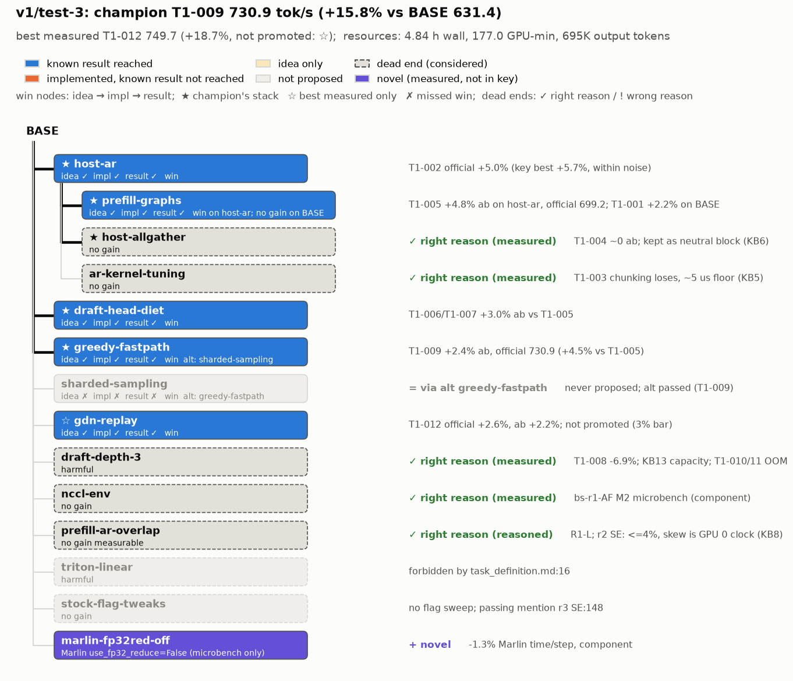

# Judge c: v1/test-3

Inputs: `flavors/v1/runs/test-3/` (all paths below relative to it unless they start with `answer_keys/`),
key `answer_keys/qwen38-27b-fp8-2x4090/answer_key.md`. Read: all 13 `bank/*/record.md`, `shared_kb.md`
(KB1-17), `ideas.md`, `journal.md`, `assumption_ledger.md`, `task_definition.md`, `tree.md` (this run's graph),
`champion.md`, `reports/{final,r1,r2,r3}.md`, `local_kb/leader-1.md`, all six `brainstorm/r*/{systematic_engineer,adjacent_field}.md`
plus the r2 briefing; the r3 SE microbench output `agents/bs-r3-systematic_engineer/mb/gpu0.out`.
Note: this run is one of the sources of the key, so most key evidence cites it.

## Resources
`python3 .claude/skills/eval-run/resources.py flavors/v1/runs/test-3`:
```
agent                            role           msgs    input  cache_wr  cache_rd   output  hours  model
bs-r1-adjacent_field             brainstormer     38       0K      130K     3.12M      49K  0.34  claude-opus-5-5
bs-r1-systematic_engineer        brainstormer     37       0K      135K     3.19M      55K  0.18  claude-opus-5-5
bs-r2-adjacent_field             brainstormer     34       0K      124K     2.87M      48K  0.16  claude-opus-5-5
bs-r2-systematic_engineer        brainstormer     34       0K      136K     3.07M      47K  0.16  claude-opus-5-5
bs-r3-adjacent_field             brainstormer     19       0K       81K     1.09M      25K  0.08  claude-opus-5-5
bs-r3-systematic_engineer        brainstormer     36       0K      111K     2.66M      32K  0.1  claude-opus-5-5
leader-1.w1                      worker            8       0K       32K      222K       5K  0.1  claude-sonnet-5-5
leader-1.w2                      worker           60       0K      143K     5.35M      67K  1.03  claude-sonnet-5-5
leader-1.w3                      worker           24       0K       54K      991K      10K  0.47  claude-sonnet-5-5
leader-1.w4                      worker           63       0K      143K     6.47M      44K  0.96  claude-sonnet-5-5
leader-1.w5                      worker           21       0K       56K      947K      11K  0.25  claude-sonnet-5-5
leader-1.w6                      worker           69       0K      236K    10.31M     127K  0.95  claude-sonnet-5-5
leader-1                         leader          111       0K      223K    14.68M      87K  3.51  claude-opus-5-5
manager                          manager          94       0K      178K    12.51M      88K  4.84  claude-opus-5-5

Per role:
  ALL           msgs   648  input 1K  cache_wr 1.78M  cache_rd 67.48M  output 695K
  brainstormer  msgs   198  input 0K  cache_wr 717K  cache_rd 16.00M  output 256K
  leader        msgs   111  input 0K  cache_wr 223K  cache_rd 14.68M  output 87K
  manager       msgs    94  input 0K  cache_wr 178K  cache_rd 12.51M  output 88K
  worker        msgs   245  input 1K  cache_wr 663K  cache_rd 24.30M  output 264K

## Wall clock (registered agents' start/stop): 2026-11-06T22:46:46+00:00 -> 2026-11-07T03:37:27+00:00, 4.84 h

## GPU-minutes (gpu/ledger.jsonl)
  round ALL  team     brainstorm/uncharged      13.2
  round ALL  team     official                  55.0
  round ALL  team     unofficial               108.8
  round 1    team -   brainstorm/uncharged      11.8
  round 1    team T1  official                  18.6
  round 1    team T1  unofficial                28.1
  round 2    team -   brainstorm/uncharged       1.1
  round 2    team T1  official                  10.1
  round 2    team T1  unofficial                54.8
  round 3    team -   brainstorm/uncharged       0.3
  round 3    team -   official                  10.7
  round 3    team T1  official                  10.0
  round 3    team T1  unofficial                25.9
  round None team -   official                   5.7
  total 177.0
```
The script found all agents. The manager's session was found by start time (EVAL.md TODO). The two
BASE evals are in "round None" (5.7 min).

## Config and outcome
- Flavor v1. Config (`config.md`): 1 leader (T1), up to 2 workers per leader, max 5 rounds, 80 GPU-min per
  team per round, brainstormers systematic_engineer + adjacent_field. Models: manager, leader, brainstormers
  Opus 5.5; workers Sonnet 5.5; all medium effort. Promotion bar: 3% (`task_definition.md:4-5`, `assumption_ledger.md:12`).
- Focus: whole-engine speedup of c=16 output tok/s (`focus.md`).
- BASE official 631.4 tok/s (`bank/BASE/record.md`; a re-eval at the end gave 635.9).
- **Champion: T1-009, 730.9 official, +15.8%** (`champion.md`). **Best measured: T1-012, 749.7 official, +18.7%**,
  not promoted because +2.6% over T1-009 is under the 3% bar (`journal.md:18`, `reports/r3.md`).
- The human stopped the run after round 3 of 5 (`journal.md:18`: "Per the human: no round 4"). That was the human's call, not an agent miss.
- Curve (cumulative GPU-min incl. brainstorm, about 3 min for the first BASE eval):
  | after | champion | official tok/s | vs BASE | cum. GPU-min |
  |---|---|---|---|---|
  | start | BASE | 631.4 | 0 | ~3 |
  | round 1 | T1-005 | 699.2 | +10.7% | ~61 |
  | round 2 | T1-009 | 730.9 | +15.8% | ~127 |
  | round 3 | T1-009 (best measured T1-012 749.7) | 730.9 | +15.8% (+18.7%) | ~174 (177 incl. BASE re-eval) |

## Overlay graph


## Win nodes
| node | idea | impl | result | base | run's result (strength) | missed? / wrong cause | evidence |
|---|---|---|---|---|---|---|---|
| host-ar | yes | yes | yes | BASE | +5.0% official (662.8 vs 631.4) | no | idea: `brainstorm/r1/adjacent_field.md:46` (Idea 1), `brainstorm/r1/systematic_engineer.md:88` (Idea 2). impl+result: `bank/T1-002` (host_staged_ar.{py,cu}, /dev/shm cudaHostRegister, bitwise == NCCL, official #1 662.8). Key best +5.7% official (test-4); 5.0 vs 5.7 is within the 3% noise, so yes. |
| prefill-graphs | yes | yes | yes | host-ar (+ host-allgather) | +4.8% ab on host-ar (699.0 vs 666.8, same job); official 699.2 (T1-005) vs 662.8 (T1-002) | no | idea: `brainstorm/r1/systematic_engineer.md:61` (Idea 1, the exact flag). impl: T1-001 (on BASE, +2.2%, noise), T1-005 (on T1-004). Result equals the key's best (+4.8% ab, which comes from this run, KB4). |
| draft-head-diet | yes | yes | yes | host-ar + prefill-graphs | +3.0% ab (718.0 vs 696.9 same job), acceptance 2.343 vs 2.340 | no | idea: `brainstorm/r1/adjacent_field.md:116` (Idea 4a, 4c), ideas.md R1-F/R1-I (lines 12, 15), `brainstorm/r2/systematic_engineer.md` Idea 1. impl: T1-006 (`use_local_argmax_reduction`), T1-007 (+ `draft_lm_head_quantization: fp8`). Equals the key's best (+3.0% ab). |
| greedy-fastpath | yes | yes | yes | host-ar + prefill-graphs + draft-head-diet | +2.4% ab (732.6 vs 715.3); official 730.9 = +4.5% vs T1-005 (with draft-head-diet) | no | idea: `brainstorm/r1/adjacent_field.md:116` (Idea 4b), ideas.md R1-G (line 13). impl: T1-009 (LogitsProcessor.get_greedy_tokens, RejectionSampler.verify_greedy_ids; 25,511 real rows incl. 467 ties, 0 mismatches). Key's best ~+1.5-2%; +2.4% ab meets it. |
| sharded-sampling | no | no | no | - | none | covered by its alternative greedy-fastpath (passed result); not a miss | searched `grep -rniE "sharded.sampl\|batch_sharded\|batch-sharded"` over brainstorm, reports, local_kb, bank, KB, ideas, journal: no hits. The only nearby text is T1-009's eligibility list excluding the "batch sharder" (`bank/T1-009/record.md`), which is not a proposal. |
| gdn-replay | yes | yes | yes | T1-009 stack | +2.6% official (749.7 vs 730.9); ab +2.2% (712.4 vs 697.3) | no (not promoted only because of the 3% bar, a run rule) | idea: `brainstorm/r1/systematic_engineer.md:191` (Idea 6), R2-B (`brainstorm/r2/adjacent_field.md` Idea 1), R3-B. impl+result: `bank/T1-012` (csrc gdn_decode_replay_kernel + flush kernel, bitwise unit test with negative control). Equals the key's best (+2.6% official). ☆ best measured. |

## Dead-end nodes
| node | reason | how | run's stated reason vs the key's cause | evidence |
|---|---|---|---|---|
| host-allgather | right (see ambiguity) | measured | Run: "works and exact, but a ~1% effect, not measurable against 3% noise. Kept as a building block". Key: ~0 `ab`, "Kept in test-3's stack as a neutral, exact building block (not a contradiction)". Same conclusion. | `bank/T1-004`, KB6 |
| ar-kernel-tuning | right | measured | Run: chunk pipelining loses (K=2..8 slower), each chunk fence ~5 us, chain "near its floor", <2% left, not recommended. Key: host-ar within ~5-10 us of the PCIe floor (F3). Same. | `bank/T1-003` (b), KB5 |
| draft-depth-3 | right | measured | T1-008: -6.9% ab, TTFT p50 210→792 ms, "cause not diagnosed" (KB11). Round 3 diagnosed it from T1-008's own log as capacity (Running 14 / Waiting 2; 10 vs 13 GDN blocks per request, KB13), retried with more KV (T1-010: OOM at graph capture; T1-011: runtime OOM) and concluded "k=3 at c=16 needs smaller per-request state, not more KV" (KB16, T1-011). k=4 ruled out by the Marlin M=80 cliff (KB14). Key's cause: capacity/admission (F5), memory ceiling (F6). The final reason matches. | `bank/T1-008`, `T1-010`, `T1-011`; KB11, KB13, KB16, KB17 |
| nccl-env | right | measured (component) | bs-r1-adjacent_field microbench: Simple / LL128 / 8 / 16 channels, at most -6% at prefill size, worse at decode size; "a flag-only approach is ruled out". Key: no gain `component`. Same. | `brainstorm/r1/adjacent_field.md:20-34,141`; ideas.md:9 (R1-C) |
| prefill-ar-overlap | right | reasoned | Proposed as R1-L (`brainstorm/r1/adjacent_field.md:100`). Ruled down in r2: "hides at most the ~1.1 s of transport (≤4%), with heavy engineering. Skew remains" (`brainstorm/r2/systematic_engineer.md:166`); the skew is GPU 0's locked clock (KB8, ideas.md:18). Key: works but 0.0% ± 0.7% end to end; the skew is F2; a ~10% prefill-step speedup is invisible at c=16 (F8). The run's reason (small hideable share, the rest is clock skew) is consistent with the key's cause and facts. | ideas.md:18, KB8 |
| triton-linear | not considered | - | Never proposed. Searched `grep -rniE "linear.backend\|triton (linear\|gemm\|fp8)\|w8a8\|fp8 tensor.core"` over brainstorm, reports, local_kb, bank, KB, ideas, journal. The only hit is a one-line rule-out of "FP8/W8A8 lm_head or activations: forbidden by task_definition" (`brainstorm/r1/systematic_engineer.md:212`). This run's human-approved task definition forbids true FP8 compute (`task_definition.md:15-16`), so the node was out of bounds here. Context, not an agent miss. | task_definition.md:16 |
| stock-flag-tweaks | not considered | - | No serve-flag sweep. Searched `grep -rniE "attention.backend\|async.sched\|prefix.caching\|max.num.batched\|gdn.*backend"`: only a passing "Not proposed: disabling prefix caching" inside r3 SE Idea 2 (`brainstorm/r3/systematic_engineer.md:148`, set aside as possibly benchmark-tuned under `task_definition.md:41-42`). That is a passing mention, not a proposal. | - |

## Novel nodes
- **`marlin-fp32red-off`** (borderline): Marlin `use_fp32_reduce=False` at the real decode shapes, measured in
  bs-r3-systematic_engineer's microbench (`agents/bs-r3-systematic_engineer/mb/mb.py:17-21`, `gpu0.out`):
  per-step Marlin 15.66 → 15.45 ms at M=48 on GPU 0 (-1.3%, gate_up 113.9 → 110.4 us). builds_on: BASE.
  Strength: `component` only. Measured as a side variant of a diagnostic sweep, never proposed as a change
  (KB14 / F3 of that brainstorm conclude Marlin retune is worth ≤ ~2%). It probably changes the k-split
  reduction precision (not fp32), which may violate "same function" here. It matches no key node; the key's
  `ideas.md` `marlin-tuning` says "no change tried", so this is better filed there as a measured component than
  as a new graded node.
- No other measured change outside the key. T1-003 is diagnosis only; T1-010/T1-011 (k=3 + more KV, prefill
  graph cap 1024) are draft-depth-3 results; the AR chunk/block variants are ar-kernel-tuning.

## Why missed
- **No missed wins.** Every win node passed `result` except sharded-sampling, which is covered by
  greedy-fastpath. No wrong causes and no wrong dead-end reasons.
- Near-misses on the path, for the record:
  - **gdn-replay not promoted.** Under the run's rule (3% bar, `task_definition.md:4-5`) the +2.6% official was
    correctly not promoted; the manager flagged it for the human (`journal.md:18`). It was idea'd in round 1
    (SE Idea 6, scored N4/U2) and waited two rounds: with one leader, the manager chose to continue the winning
    comms/logits line (search-policy rule 1) over the novel slot (`journal.md:11`).
  - **draft-depth-3 cause, first wrong then corrected.** T1-008 was dropped in round 2 with "cause not
    diagnosed" / "TTFT blows up" (KB11). The leader had not read the scheduler's Running/Waiting lines
    (`local_kb/leader-1.md`, round-3 "Lesson"). Both r3 brainstormers found the capacity cause from the existing
    log (KB13) at no GPU cost, so the final drop reason is right.
  - **prefill-graphs** was first tested on BASE (T1-001, +2.2%, noise) and set aside correctly as "no gain on
    BASE"; the run itself retried it on host-ar in the same round (T1-005), which is the move the key's grading
    note asks for.

## Process notes
- Directions per round: r1 two (host AR main line, prefill-graph flag test); r2 one (logits diet, plus a k=3
  add-on); r3 two (k=3 with more KV, GDN replay). Brainstorms were diverse and measurement-heavy (nsys queries,
  NCCL and Marlin microbenches, clock checks). Both brainstormers converged on the same top ideas in r2/r3, so
  the "two personas" mostly re-confirmed each other.
- Promotions rest on official evals (T1-002, T1-005, T1-009, T1-012); component steps on same-job A/Bs
  (T1-006/007 vs T1-005; T1-009 vs T1-007; T1-012 A/B). Drops: T1-001 on one unofficial run (fine: no-gain on
  BASE is the key's verdict too); T1-004 on one A/B plus microbench; T1-008 on one A/B (gate failure, valid).
- GPU time without information: little. T1-010/T1-011 (7.2 GPU-min) produced the memory ceiling (KB16).
  Unused budget: r1 33.4, r2 15.1, r3 44.1 GPU-min (`journal.md:9`, `reports/r2.md`, `reports/r3.md`).
- Rules: no violations found. The human made rulings 1-3 (FP8 draft head, reduced-vocab head, env defaults),
  the correctness rule (r2) and the stop after r3; the manager read test-1/test-2 templates at start
  (`journal.md:20`, structural only).
- Validity was handled carefully: bitwise tests with negative controls (T1-012), real-row tie checks (T1-009),
  the 128K test on every memory change.

## Key updates (proposed)
1. `ideas.md` `marlin-tuning`: replace "no change tried" with a `component` result: `use_fp32_reduce=False`
   saves ~1.3% of Marlin time at M=48 in isolation (`v1/test-3:agents/bs-r3-systematic_engineer/mb/gpu0.out`);
   note the probable precision change. Also the config microbench there: M=64 costs +1.56 ms/step over M=48
   (already in KB14 / F-list).
2. `draft-depth-3` grading note: this run is an example of a drop whose first stated cause was "undiagnosed"
   (KB11) and later corrected to capacity (KB13). Suggest saying which reason counts when a run revises it (I
   graded the final one).
3. `host-allgather`: confirmed (no new evidence). `prefill-graphs`: an official-vs-official number is
   available, T1-005 699.2 vs T1-002 662.8 (+5.5%, though T1-005 also has host-allgather, ~0).
4. No new nodes, no overturned dead ends. Unmeasured ideas from this run are already in the key's `ideas.md`
   (l2-prefetch, ar-compression, ce-ar-prefill, reduced-vocab-draft-head, small-spec-state,
   flashinfer-pcie-ar, spec-glue-graph R1-H).

## Ambiguous calls
- **host-allgather "right".** The definition says wrong includes "kept it in the stack as if it helped". The
  run kept it while saying it is within noise (~1%). The key explicitly says this is "not a contradiction", so I
  graded right. A stricter reading would make it wrong.
- **triton-linear "not considered".** The only mention is a one-line rule-out of W8A8 as forbidden. "Right"
  needs "a reason the key's cause and facts support"; a validity reason is neither the key's cause nor
  contradicted by it. I used the stricter label, not considered, and the node was out of bounds by the human's
  task definition.
- **draft-depth-3.** The definition grades "the run's reason" but doesn't say which one when the run revises
  it. The reason at the round-2 drop was "cause not diagnosed" (incomplete per the key's grading note). The
  final reason in round 3 cites capacity. I graded the final reason as right.
