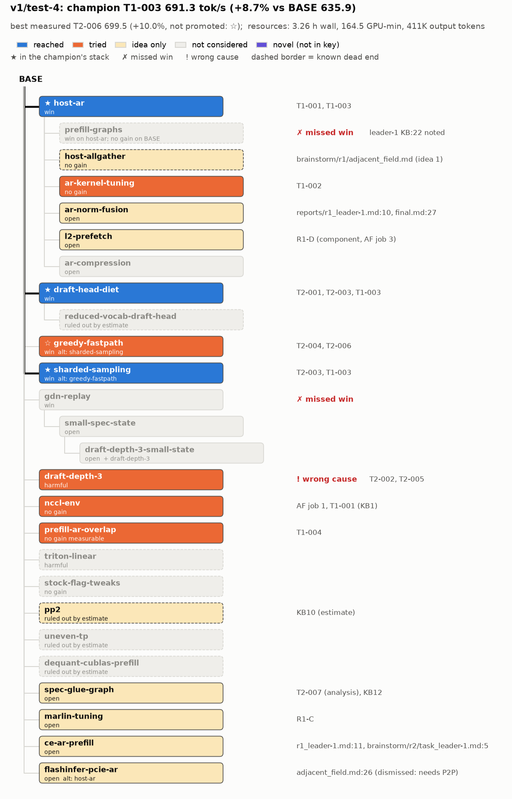

# Judge b: v1/test-4

## Resources
`python3 .claude/skills/eval-run/resources.py flavors/v1/runs/test-4`:
```
agent                            role           msgs    input  cache_wr  cache_rd   output  hours  model
bs-r1-adjacent_field             brainstormer     47       0K      127K     4.34M      41K  0.47  claude-opus-5-5
bs-r1-systematic_engineer        brainstormer     59       0K      118K     5.13M      42K  0.47  claude-opus-5-5
leader-1.w1                      worker           66       0K      152K     6.02M      64K  1.47  claude-sonnet-5-5
leader-1.w2                      worker           54       0K      113K     4.08M      37K  1.21  claude-sonnet-5-5
leader-1                         leader           66       0K      150K     6.49M      56K  2.76  claude-opus-5-5
leader-2.w1                      worker           56       0K      131K     5.28M      31K  0.37  claude-sonnet-5-5
leader-2.w2                      worker           54       0K      120K     3.90M      45K  0.41  claude-sonnet-5-5
leader-2                         leader           85       0K      175K     9.75M      51K  2.76  claude-opus-5-5
manager                          manager          52       0K      102K     5.20M      43K  3.26  claude-opus-5-5
Per role:
  ALL           msgs   539  input 1K  cache_wr 1.19M  cache_rd 50.19M  output 411K
  brainstormer  msgs   106  cache_wr 244K  cache_rd 9.47M  output 84K
  leader        msgs   151  cache_wr 325K  cache_rd 16.24M  output 107K
  manager       msgs    52  cache_wr 102K  cache_rd 5.20M  output 43K
  worker        msgs   230  cache_wr 516K  cache_rd 19.28M  output 177K
Wall clock: 2026-11-07T03:48:48Z -> 07:04:34Z, 3.26 h
GPU-minutes: brainstorm/uncharged 19.8, official 41.5, unofficial 103.2; total 164.5
  r1: T1 official 20.9 + unofficial 29.9; T2 official 10.0 + unofficial 19.6
  r2: T1 unofficial 26.9; T2 official 10.6 + unofficial 26.8
```
Nothing missing: all 9 agents found (manager transcript located by start time, per EVAL.md TODO).

## Config and outcome
- Flavor v1; 2 leaders x 1 worker, 2 rounds, 55 GPU-min/team/round, brainstormers systematic_engineer + adjacent_field;
  Opus 5.5 for manager/leaders/brainstormers, Sonnet 5.5 for workers (config.md). Focus: whole-engine c=16 tok/s (focus.md).
- Human decisions (context, not agent choices): Q1-Q8 defaults + FP8 draft head allowed (journal 03:50); search policy rule 1
  edited mid-run so every leader that beat the champion continues its own "next" (journal 03:54) -> this fixed both r2 slots,
  and the manager skipped the r2 brainstorm because no slot was free (journal 05:49). Run stopped at max rounds (2).
- BASE 635.9 official (bank/BASE). Champion **T1-003 691.3 official (+8.7%)** = host-ar + draft-head-diet + sharded-sampling
  (champion.md; bank/T1-003/record.md). Best measured: T2-006 699.5 official (+10.0%), but ABAB same-job +0.2% vs T1-003,
  correctly not promoted (bank/T2-006/record.md; journal 06:59).
- Curve (champion vs cumulative GPU-min, from the ledger): 0 -> 635.9; end of r1 (~100 GPU-min) -> 691.3; end of r2
  (164.5 GPU-min) -> 691.3 (no gain in r2).

## Overlay graph


```
BASE
├─ host-ar  [win]                         reached (T1-001, T1-003)         as expected
│  ├─ prefill-graphs  [win on host-ar]    not-considered (fact noted)      MISSED WIN
│  ├─ host-allgather  [no gain]           idea-only                        -
│  ├─ ar-kernel-tuning  [no gain]         tried (T1-002)                   as expected
│  ├─ ar-norm-fusion  [open]              idea-only                        -
│  ├─ l2-prefetch  [open]                 idea-only (component measured)   -
│  └─ ar-compression  [open]              not-considered                   -
├─ draft-head-diet  [win]                 reached (T2-001/T2-003/T1-003)   as expected
│  └─ reduced-vocab-draft-head            not-considered                   -
├─ greedy-fastpath  [win] alt             tried (T2-004, T2-006); alt reached   as expected
├─ sharded-sampling  [win] alt            reached (T2-003, T1-003)         as expected
├─ gdn-replay  [win]                      not-considered                   MISSED WIN
│  └─ small-spec-state / draft-depth-3-small-state   not-considered        -
├─ draft-depth-3  [harmful]               tried (T2-002, T2-005)           WRONG CAUSE
├─ nccl-env  [no gain]                    tried (component)                as expected
├─ prefill-ar-overlap  [no gain meas.]    tried (T1-004)                   as expected
├─ triton-linear / stock-flag-tweaks / uneven-tp / dequant-cublas-prefill   not-considered  -
├─ pp2  [ruled out]                       idea-only (estimate)             as expected
├─ spec-glue-graph  [open]                idea-only (T2-007 analysis)      -
├─ marlin-tuning  [open]                  idea-only (R1-C)                 -
├─ ce-ar-prefill  [open]                  idea-only                        -
└─ flashinfer-pcie-ar  [open]             idea-only (dismissed, needs P2P) -
```
(In the PNG, greedy-fastpath carries a star because the plot marks `best_measured.adds`; it is not in the champion stack.)

## Overlay
Search for absence claims: `grep -rniE` over bank/*/record.md, bank/*/profiles/*.md, brainstorm/r1+r2/*, ideas.md,
shared_kb.md, journal.md, local_kb/*, reports/r*.md, final.md, tree.md, agents/leader-2.w2/REPORT_*.md with patterns listed per row.

| node | contact | base | run's result and cause | verdict | evidence |
|---|---|---|---|---|---|
| host-ar | reached | BASE; then + draft-head-diet + sharded-sampling | +5.7% official alone (672.5); +5.7% on T2-003 (691.3); bitwise = NCCL; decode AR 61.4 -> 44.5 us | as expected | T1-001, T1-003, KB2, KB7 |
| prefill-graphs | not-considered | - | Leader-1 wrote down "graphs <=96 tokens; prefill steps eager" in r2 but went for AR overlap instead; never tested the capture flag | missed win | local_kb/leader-1.md:22; grep `prefill_cudagraph|max_prefill|prefill.*graph` no other hits |
| host-allgather | idea-only | - | AF: "same building block also serves the logits all-gather"; superseded by head diet + sharded sampling | - | brainstorm/r1/adjacent_field.md idea 1 |
| ar-kernel-tuning | tried | host-ar | unified blocks -2 us, per-warp flags worse; cause: ~10 us off PCIe floor, polling contention (component) | as expected | T1-002, KB3 |
| ar-norm-fusion | idea-only | - | listed as left open (~1.6 ms/step norms etc.) | - | reports/r1_leader-1.md:10; reports/final.md:27 |
| l2-prefetch | idea-only | - | AF measured L2-hot Marlin 41-48 us vs 50-56 in-server, ceiling ~+3% (component); not selected | - | R1-D (ideas.md); adjacent_field.md idea 4 |
| ar-compression | not-considered | - | - | - | grep `compress`: no hits |
| draft-head-diet | reached | BASE | +2.4% ab, acceptance unchanged | as expected | T2-001, KB4 |
| reduced-vocab-draft-head | not-considered | - | allowed by task_definition.md:27 but never proposed | - | grep `reduced.?vocab|vocab.*subset`: only task_definition |
| greedy-fastpath | tried (alt sharded-sampling reached) | BASE+draft-head-diet; host-ar+draft-head-diet | no gain vs sharded-sampling (ab); 699.5 official on host-ar but ABAB +0.2% | as expected | T2-004, T2-006, KB5, KB11 |
| sharded-sampling | reached | BASE + draft-head-diet | 653.9 official (+2.8% with head diet) | as expected | T2-003 |
| gdn-replay | not-considered | - | GDN decode (2.4-3.8 ms/step) appears in every anatomy, but no idea targeted the k+1 state writes | missed win | systematic_engineer.md:16, KB10, T2-005 (GDN 3.84->4.63); grep `gdn|recurrent state|replay` has no idea |
| small-spec-state | not-considered | - | - | - | grep `spec.?state|mamba.*block|admission|capacity`: no hits |
| draft-depth-3-small-state | not-considered | - | - | - | same grep |
| draft-depth-3 | tried | BASE+draft-head-diet (T2-002); host-ar+draft-head-diet+sharded-sampling (T2-005) | -3.9% ab, flat (nsys); dropped for "step cost rises more" and "prefill steps dilute"; TTFT jump "cause not established, queueing behind 2048-token prefill chunks suspected" | wrong cause | T2-002 conclusion; T2-005 conclusion; KB6, KB13; REPORT_job1.md:30 |
| nccl-env | tried | BASE | all protocol/channel knobs equal or worse at decode and prefill sizes (component) | as expected | KB1; adjacent_field.md (NCCL bench); T1-001 results |
| prefill-ar-overlap | tried | host-ar+draft-head-diet+sharded-sampling | big prefill steps -10% (nsys), 0.0% in 400-prompt ab; Marlin must reserve SMs | as expected | T1-004, KB14, KB15 |
| triton-linear | not-considered | - | - | - | grep `linear-backend|triton.*(linear|gemm)`: no hits |
| stock-flag-tweaks | not-considered | - | (max_num_batched_tokens only mentioned as a check, never run) | - | local_kb/leader-2.md:18 |
| pp2 | idea-only | - | ruled out by napkin math (doubles weight streaming) | as expected | KB10; systematic_engineer.md (PP=2 paragraph); adjacent_field.md idea 4 |
| uneven-tp | not-considered | - | - | - | grep `uneven|clock|2235`: no hits |
| dequant-cublas-prefill | not-considered | - | - | - | grep `dequant|cublas`: only the Marlin dequant remark |
| spec-glue-graph | idea-only | host-ar+draft-head-diet+greedy-fastpath (analysis) | real idle ~1.6 ms/step, 1.24 ms CPU Python in FlashInfer metadata builds; one-graph capture est. 3-4%, judged invasive, not tried | - | T2-007, KB12, REPORT_glue.md:12, REPORT_job1.md:32 |
| marlin-tuning | idea-only | - | R1-C scored U2, not selected (AF: L2-hot Marlin near floor) | - | ideas.md R1-C; scores.md |
| ce-ar-prefill | idea-only | - | proposed as one option for r2 overlap; worker built SM/NCCL side-stream overlap instead | - | reports/r1_leader-1.md:11; brainstorm/r2/task_leader-1.md:5; T1-004 change |
| flashinfer-pcie-ar | idea-only | - | dismissed by code reading: built on CUDA-IPC device buffers, needs P2P (not run) | - | adjacent_field.md:26-28; systematic_engineer.md:66; brainstorm/r1/task_leader-1.md:15 |

## Novel nodes
None that adds a new canonical change. Closest: leader-2.w2's sub-options for the glue (skip no-op eager launches; overlap the
sharded-sampling SendRecv with sampling kernels, REPORT_job1.md:32-34) and T1-004's Marlin SM-reserve mechanism; both are covered by
`spec-glue-graph` and `prefill-ar-overlap`.

## Why missed
- **prefill-graphs (missed win).** Closest approach: leader-1 r2 read the engine and recorded "compilation mode NONE, graphs <=96
  tokens; prefill steps eager" (local_kb/leader-1.md:22), while working on the prefill steps (35-38% of wall, KB13). The path
  diverged because the r2 direction was fixed to leader-1's own "next" (AR overlap; reports/r1_leader-1.md:11, search policy rule 1
  as edited by the human) and the eager-prefill fact was treated as context, not a lever. No brainstorm in r2 (journal 05:49), so no
  one else could surface it. Mostly: surfaced as a fact, never turned into an idea; no free slot to try it.
- **gdn-replay (missed win).** Never surfaced. Both brainstormers measured GDN decode (2.4 ms SE, 3.7 ms AF; systematic_engineer.md:16,
  adjacent_field.md step anatomy) and T2-005 saw it grow 3.84 -> 4.63 ms with depth, but every idea went to AR, drafter head, Marlin
  or glue. The r1 brainstorm was the only one; with 2 slots both went to the two biggest measured items. Plain words: the 6-10%
  GDN slice was below every brainstormer's cut, and the run had no second brainstorm.
- **draft-depth-3 (wrong cause).** The drop itself was right (harmful on both bases, TTFT p99 gate fail; T2-002, T2-005). But the stated
  causes were step cost (T2-002: "step cost rises more") and prefill dilution / queueing behind prefill chunks (T2-005;
  REPORT_job1.md:30), with the TTFT cause explicitly "not established" (KB13). The key's cause is GDN spec-state blocks per request
  (10 -> 13) shrinking admitted concurrency below 16 (F5). The run had the symptom in hand (TPOT -16%, total duration unchanged,
  TTFT p50 334 -> 938; REPORT_job1.md:30) but did not check scheduler running/waiting counts or KV block usage (grep
  `admission|capacity|spec.?state|kv pool`: no hits). That missing link is also why small-spec-state never surfaced.

## Process notes
- Diversity: r1 had two orthogonal directions (comm, drafter head), chosen by both brainstormers independently (journal 04:18);
  r2 had no brainstorm, both slots continued r1 lines by rule. GDN, prefill graphs, flags/compile config were never covered.
- Evidence: promotions all rest on official evals (T2-003, T1-001, T1-003); the close call T2-006 was correctly settled with an ABAB
  same-job A/B rather than the official +1.2% (journal 06:35, 06:59). Drops rest on ab (T2-002, T2-004), 400-prompt ab (T1-004), or
  component (T1-002). Good measurement hygiene; KB11 is a real lesson.
- Productive GPU: r1 delivered the whole gain (~100 GPU-min). r2 spent ~64 GPU-min on two nulls (T1-004 hack-grade kernel+Marlin
  build; depth 3 retried on the champion even though KB6 had already failed the gate) plus one official eval (T2-006) for a tie.
  Re-testing depth 3 (T2-005) without the capacity hypothesis was the least informative spend, though it yielded the
  nsys-artifact finding (KB12).
- The ~4 ms/step idle in KB8 was correctly re-examined and downgraded to ~1.6 ms as a node-level nsys artifact (KB12, T2-005).
- Prefill-step AR skew (p50 ~174-196 us; systematic_engineer.md, KB8) was never traced to GPU 0's locked clock (F2); grep
  `clock` found nothing. Not a miss on any win node, but the run's prefill-overlap estimate omitted it.
- No rule violations seen: FP8 draft head ruled allowed before use (journal 04:19); exactness argued and tested per record.

## Key updates (proposed)
1. `flashinfer-pcie-ar`: add a code-reading result (estimate strength): FlashInfer PCIe-IPC AR uses `cuda_ipc.create_shared_buffer`
   (CUDA-IPC device buffers), i.e. peer device access, so it likely can't run without P2P (`v1/test-4:brainstorm/r1/adjacent_field.md:26`).
   Keep open (never run), but lower priority.
2. `ar-norm-fusion`: add the location fact: in this engine the TP AR runs inside the norm (`use_fused_allreduce_norm` fallback,
   `Qwen3_5RMSNorm.forward_fused`), not in RowParallelLinear (`v1/test-4:local_kb/leader-1.md:22`, T1-004 change text) -> the fusion
   site already exists.
3. `spec-glue-graph`: add the specific cause found: with spec tokens, the FlashInfer metadata build takes `seq_lens.cpu()` under a
   sync instead of the upper-bound shortcut, plus numpy cumsum/copy_to_gpu, once per target and drafter pass
   (`v1/test-4:agents/leader-2.w2/REPORT_glue.md:12`); a cheaper sub-option than a full one-graph capture.
4. `draft-depth-3`: add the run's grading example: test-4 attributed it to step cost / prefill dilution (T2-002, T2-005), i.e. the
   incomplete cause in the key's grading note. No status change.
5. `ce-ar-prefill`: note it was proposed but the run implemented SM/NCCL overlap instead (`v1/test-4:reports/r1_leader-1.md:11`,
   T1-004); F9 (Marlin persistent grid) applies to SM-based overlap but not to a copy-engine AR, which is a reason to keep it open.
