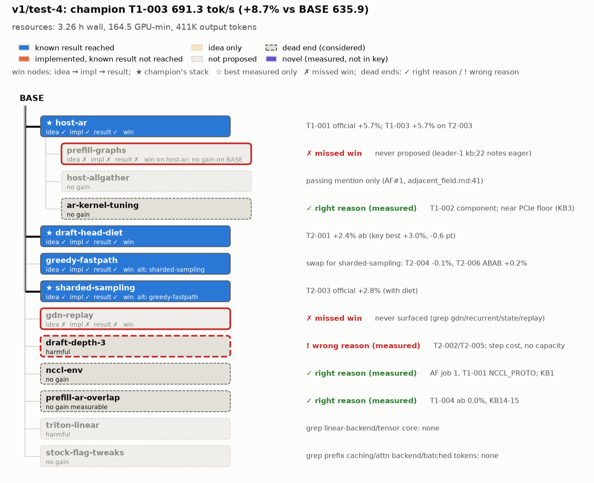

# Judge c: v1/test-4

## Resources
```
# Resources used: flavors/v1/runs/test-4

## Tokens (unique assistant messages; cache reads are cheap but counted separately)
agent                            role           msgs    input  cache_wr  cache_rd   output  hours  model
bs-r1-adjacent_field             brainstormer     47       0K      127K     4.34M      41K  0.47  claude-opus-5-5
bs-r1-systematic_engineer        brainstormer     59       0K      118K     5.13M      42K  0.47  claude-opus-5-5
leader-1.w1                      worker           66       0K      152K     6.02M      64K  1.47  claude-sonnet-5-5
leader-1.w2                      worker           54       0K      113K     4.08M      37K  1.21  claude-sonnet-5-5
leader-1                         leader           66       0K      150K     6.49M      56K  2.76  claude-opus-5-5
leader-2.w1                      worker           56       0K      131K     5.28M      31K  0.37  claude-sonnet-5-5
leader-2.w2                      worker           54       0K      120K     3.90M      45K  0.41  claude-sonnet-5-5
leader-2                         leader           85       0K      175K     9.75M      51K  2.76  claude-opus-5-5
manager                          manager          52       0K      102K     5.20M      43K  3.26  claude-opus-5-5

Per role:
  ALL           msgs   539  input 1K  cache_wr 1.19M  cache_rd 50.19M  output 411K
  brainstormer  msgs   106  input 0K  cache_wr 244K  cache_rd 9.47M  output 84K
  leader        msgs   151  input 0K  cache_wr 325K  cache_rd 16.24M  output 107K
  manager       msgs    52  input 0K  cache_wr 102K  cache_rd 5.20M  output 43K
  worker        msgs   230  input 0K  cache_wr 516K  cache_rd 19.28M  output 177K

## Wall clock (registered agents' start/stop): 2026-11-07T03:48:48+00:00 -> 2026-11-07T07:04:34+00:00, 3.26 h

## GPU-minutes (gpu/ledger.jsonl)
  round ALL  team     brainstorm/uncharged      19.8
  round ALL  team     official                  41.5
  round ALL  team     unofficial               103.2
  round 1    team -   brainstorm/uncharged      19.8
  round 1    team T1  official                  20.9
  round 1    team T1  unofficial                29.9
  round 1    team T2  official                  10.0
  round 1    team T2  unofficial                19.6
  round 2    team T1  unofficial                26.9
  round 2    team T2  official                  10.6
  round 2    team T2  unofficial                26.8
  total 164.5
```
All 9 agents' transcripts were found. The manager's session id is not recorded (EVAL.md TODO), so resources.py finds it by start time.
Brainstormer profiling (19.8 GPU-min) is charged to no team.

## Config and outcome
- Flavor v1. Config (`config.md`): 2 leaders (T1, T2), 1 worker per leader at a time, 2 rounds, 55 GPU-min per team per round, brainstormers systematic_engineer + adjacent_field (round 1 only). Models: Opus 5.5 (manager, leader, brainstormer), Sonnet 5.5 (worker), all at medium effort. Focus is the whole engine (`focus.md`).
- Human decisions (context, not agent choices): the runs are independent and the drafter allowances were granted (journal.md:1-2). The human changed search-policy rule 1 mid-run, so every leader that beat the champion continues (journal.md:4). Because both leaders beat BASE, there was no round-2 brainstorm (journal.md:12). The run stopped at max rounds (journal.md:15).
- Manager decisions: in round 1 it moved T2's unused 25.4 GPU-min to T1 (journal.md:9). It asked for an ABAB re-test of T2-006 before deciding (journal.md:13-14).
- BASE 635.9 tok/s official (bank/BASE). Champion: **T1-003, 691.3 tok/s official, +8.7%** (champion.md). The stack is host-ar + draft-head-diet + sharded-sampling.
- Curve:

  | point | champion | cumulative GPU-min |
  |---|---|---|
  | start | BASE 635.9 | 0 |
  | after r1 | T1-003 691.3 (+8.7%) | ~100 (T1 50.8 + T2 29.6 + brainstorm 19.8) |
  | after r2 | T1-003 unchanged | 164.5 |

  Round 2 added no gain. Its best official number was T2-006 at 699.5 (+10.0%), but ABAB showed only +0.2% vs T1-003, so it was not promoted (bank/T2-006/record.md; reports/r2.md).

## Overlay graph


## Win nodes
Re-graded against the tightened EVAL.md (result = run gain >= key best - 1.6 pt; swap rule for alternatives; neutral-block rule; final-reason rule). Change: greedy-fastpath result no -> yes via the swap rule. All other labels unchanged.

Base ids are key ids.

| node | idea | impl | result | base | run's result (strength) | missed? / wrong cause | evidence |
|---|---|---|---|---|---|---|---|
| host-ar | yes | yes | yes | BASE; also BASE+draft-head-diet+sharded-sampling | +5.7% official (T1-001); +5.7% official on T2-003's stack (T1-003 691.3 vs 653.9) | - | idea: brainstorm/r1/systematic_engineer.md:60-79 (#2), adjacent_field.md:33-62 (#1), scores.md R1-A. impl+result: bank/T1-001/record.md (microbench, bitwise test, A/Bs +4.1/+5.2%, official 672.5). Matches the key's best (+5.7%), which comes from this run. |
| prefill-graphs | no | no | no | - | none | **missed** (never proposed) | Searched `prefill_cudagraph\|max_prefill\|cudagraph_capture\|capture.?size\|eager\|prefill.*graph` over bank, shared_kb, ideas, brainstorm, journal, local_kb, reports, agents/*.md. Closest: local_kb/leader-1.md:22 "graphs <=96 tokens; prefill steps eager" (an observation, not a proposal) and local_kb/leader-2.md:18 "Check the cudagraph capture sizes ..." (asked about TTFT p99, not a proposal to graph prefill steps). |
| draft-head-diet | yes | yes | yes | BASE | +2.4% ab on BASE (T2-001, 608.0 vs 593.6). Also +2.8% official together with sharded-sampling (T2-003) | - | idea: systematic_engineer.md:34-58 (#1), adjacent_field.md:181-197 (#2a, 2c). impl: T2-001 serve_args, with log lines "Quantized a fp8 copy of the lm_head" and "Using local argmax reduction" (bank/T2-001/record.md). result: the key's best is +3.0% ab (test-3); +2.4% >= 3.0 - 1.6 pt, so yes (this is EVAL.md's own example). |
| greedy-fastpath | yes | yes | yes | BASE+draft-head-diet (T2-004); host-ar+draft-head-diet (T2-006) | measured only as a swap for sharded-sampling: equal (T2-004 633.5 vs T2-003 634.4 same job, -0.1%); T2-006 vs T1-003 +0.2% ABAB (job 26), +1.2% official | - (passes via EVAL.md swap rule: equal within 1.6 pt to its alternative, which passed result) | idea: systematic_engineer.md:81-94 (#3), adjacent_field.md:185-187 (#2b). impl: T2-004 (0/9600 mismatches, fast-path log line on both ranks in server). result: bank/T2-004/record.md performance line; bank/T2-006/record.md ABAB block; sharded-sampling passed result (row below). |
| sharded-sampling | yes | yes | yes | BASE+draft-head-diet | +2.8% official for draft-head-diet + sharded-sampling (T2-003 653.9); alone over T2-001 +1.4% ab (616.5 vs 608.0, job 1) | - | idea: local_kb/leader-2.md:3-4 ("Existing flag --enable-batch-sharded-sampling ... Testing as arm E"), with hypothesis in bank/T2-003/record.md. impl+result: T2-003 official. The key's only result for this node is this measurement. |
| gdn-replay | no | no | no | - | none | **missed** (never surfaced) | Searched `gdn\|recurrent\|mamba state\|ssm state\|spec.?state\|replay` over the same files. GDN appears only as a profile line item (KB10; bank/T1-003/profiles/anatomy.md:13; REPORT_job1.md:20 "GDN +0.8 ms at depth 3"). No proposal to change GDN state writes. |

## Dead-end nodes
| node | reason | how | run's stated reason vs the key's cause | evidence |
|---|---|---|---|---|
| host-allgather | not considered | - | Only a passing mention inside the host-AR idea: "The same building block also serves the logits all-gather (Idea 2) if wanted" (adjacent_field.md:41). The run took the logits-gather lever by removing the gathers (draft-head-diet, sharded-sampling, greedy fast path). | Searched `all.?gather` combined with host/custom/stag. |
| ar-kernel-tuning | right | measured (component) | Run: "within ~10 us of the link's practical floor at T=48; flag polling over PCIe is expensive" (T1-002; KB3). Key: host-ar is within ~5-10 us of the PCIe floor (F3). These agree. | bank/T1-002/record.md; shared_kb.md:8-9 |
| draft-depth-3 | **wrong** | measured (ab; nsys) | Run: "step cost rises more than tokens" (T2-002). On the champion: "extra verify cost eats most of the extra accepted tokens and prefill-heavy steps dilute it; TTFT degrades (cause not established; queueing behind 2048-token prefill chunks suspected)" (T2-005; KB6, KB13). Key: the capacity/admission cause (F5): more GDN spec-state blocks per request, so only 14 of 16 requests fit. The key's grading line says "step cost" or "queueing behind prefill steps" without the capacity cause is wrong or incomplete. The run saw the symptom ("TPOT drops 16% but total duration is unchanged ... the gain moved from decode to queueing", REPORT_job1.md:30) but never looked at KV blocks or the waiting queue. | Searched `kv.?(block\|pool\|capacity)\|admission\|waiting\|block.*per request`: no hits outside prompts. |
| nccl-env | right | measured (component) | Run: every NCCL knob (protocol, channels, LL128) is worse or equal at T=16-96 (adjacent_field.md:22-27). NCCL_PROTO=Simple at T=256-2048 gives no gain (T1-001 record). KB1. This matches the key (no gain). | adjacent_field.md:22-27; bank/T1-001/record.md:23; shared_kb.md:3-4 |
| prefill-ar-overlap | right | measured (ab 0.0% over 400 prompts x2; nsys) | Run: works mechanically (needs a Marlin SM reserve), big prefill steps -10%, but end-to-end 0.0% because step-mix variation at c=16 is as large as the gain (T1-004; KB14-15). This matches the key's cause and revisit condition (the key's entry comes from this record). | bank/T1-004/record.md; bank/T1-004/profiles/why.md |
| triton-linear | not considered | - | The run knew Marlin is weight-only FP8 (task log "Weight-only FP8 compression will be used leveraging the Marlin kernel") but never proposed the Triton or another true-FP8 linear backend for the target. | Searched `linear.backend\|triton.*(gemm\|linear\|fp8)\|tensor.?core\|scaled_mm`. The only hits are the drafter FP8 head (CutlassFP8 for lm_head). |
| stock-flag-tweaks | not considered | - | None of the key's flags (prefix caching off, attention backend, GDN backend, max-num-batched-tokens, async scheduling) was proposed or run. | Searched `prefix.cach\|attention.backend\|max.num.batched\|async.sched\|gdn.*backend`. The only hit is a log observation (REPORT_job1.md:29). |

## Novel nodes
None. Every measured change matches a key node:
- T1-001 and T1-003 are host-ar (+ diet + sharded-sampling).
- T1-002 is ar-kernel-tuning.
- T1-004 is prefill-ar-overlap.
- T2-001 is draft-head-diet.
- T2-002 and T2-005 are draft-depth-3.
- T2-003 is sharded-sampling.
- T2-004 and T2-006 are greedy-fastpath.

T2-007 is analysis only, with no change (bank/T2-007/record.md). adjacent_field's L2-hot Marlin microbench (adjacent_field.md:89-97) measured a ceiling, not an implemented prefetch, so it stays as `l2-prefetch` in the key's ideas.md. The Marlin SM-reserve env (`VLLM_MARLIN_SM_RESERVE`) is a component of T1-004 and was not measured on its own end-to-end.

## Why missed
- **prefill-graphs** (stopped before idea). The closest approach was in round 2: leader-1 read the engine config and wrote "graphs <=96 tokens; prefill steps eager" (local_kb/leader-1.md:22) while setting up T1-004. T2-005 also measured prefill-containing steps at 35-38% of wall (REPORT_job1.md:28). The run treated the eager prefill steps only as the place to overlap ARs (T1-004). It never asked whether graphing them would help. Round 2 had no brainstorm (both slots went to the leaders' own "next" under rule 1), and that was the last round, so no one could surface it. Summary: never surfaced. A fact sitting in a local KB was not turned into an idea.
- **gdn-replay** (stopped before idea). The closest approach: GDN cost was profiled (KB10 "GDN decode ~2.4-3.7"; bank/T1-003/profiles/anatomy.md) and seen to grow with depth (REPORT_job1.md:20, +0.8 ms). Neither brainstormer proposed changing GDN spec-state handling. Both ranked GDN below AR, Marlin and the lm_head. Summary: never surfaced. It is a small item in the profile, and there was no second brainstorm.
- **draft-depth-3, wrong reason** (graded on the final reason, KB13 / T2-005). It was dropped twice on measurements (T2-002, T2-005), which was the right decision. The explanation was step cost plus prefill dilution, and the TTFT jump was left "cause not established" (KB13). The worker noticed that decode time moved into queueing (REPORT_job1.md:30) but never checked the scheduler's running/waiting counts or KV blocks per request. That check would have exposed the capacity cause (F5). The diagnosis stopped one step short.

## Process notes
- **Diversity.** Round 1 ran 2 directions (AR, drafter/head), both the two brainstormers' top bets. Marlin, L2 prefetch and NCCL env went to ideas.md, each with measured reasons (scores.md). Round 2 ran both leaders' own next steps (prefill AR overlap; depth-3 cost / decode idle). Both were second steps along round-1 lines, with no new axis, because of rule 1 and no brainstorm. GDN, compilation/graphs, scheduler and memory were never explored.
- **Evidence behind decisions.**
  - Promotions rest on official evals (T2-003, T1-001, T1-003).
  - T2-006 was correctly held back after an ABAB (journal.md:13-14). That is good practice, and it corrected a misleading one-server-per-arm A/B (KB11).
  - Drops rest on measurements: T1-002 by microbench, T2-002 and T2-005 by ab/nsys, T1-004 by a 400-prompt ab x2, T2-004 by ab.
  - T2-001's +2.4% came from one run per arm. It was re-confirmed only as part of T2-003.
- **Wasted or low-information spend.**
  - Leader-2's round 1 job 1 arm C was contaminated by a worker editing code during a job and had to be re-measured (reports/r1_leader-2.md; local_kb/leader-2.md:10).
  - Round 2 T2 spent ~10.6 GPU-min on the T2-006 official eval for a change that then tied under ABAB. Defensible, given the collect rule.
  - T2-005's depth-3 re-test was a profiling job that was needed to close the question. It did not pin down the cause.
  - T1-004 cost ~27 GPU-min plus a C++ build for a null result. It was an honest test of the leader's own estimate.
  - T2 used 29.6 of 55 GPU-min in r1 and gave the rest to T1; T1 left 29.2 unused (journal.md:11).
- **Reason timeline (depth 3).** The reason was never revised to the capacity cause: "step cost" in r1 (T2-002, KB6), "prefill dilution; TTFT cause unknown" in r2 (T2-005, KB13), standing to the end of the run.
- **Rules.** I found no violations. FP8 draft head was ruled allowed by the manager under the human's allowances (journal.md:8). Exactness was checked for every promoted change (bitwise AR; drafter-only FP8).

## Key updates (proposed)
- **sharded-sampling:** add the isolated result on BASE+draft-head-diet: +1.4% ab (T2-003 616.5 vs T2-001 608.0, same job 1; `v1/test-4:T2-003`). This separates it from the combined +2.8% official.
- **draft-depth-3:** add the observation "TPOT -16% with total duration unchanged" as a symptom. It is already cited from REPORT_job1.md:30. No change needed.
- **prefill-graphs:** under grading, note that `v1/test-4:local_kb/leader-1.md:22` came close (the observation was made, nothing was proposed). This is already reflected.
- **ideas.md:** add leader-2.w2's unmeasured proposals:
  - (A) prune no-op eager launches in the inter-graph window, est. 1.5-3% (REPORT_job1.md:32);
  - (C) overlap batch-sharded sampling's SendRecv with sampling kernels.

  One-graph capture of the spec-decode glue (KB12) is already `spec-glue-graph` in ideas.md.
- No overturned or new dead ends. The run measured no new open node.
