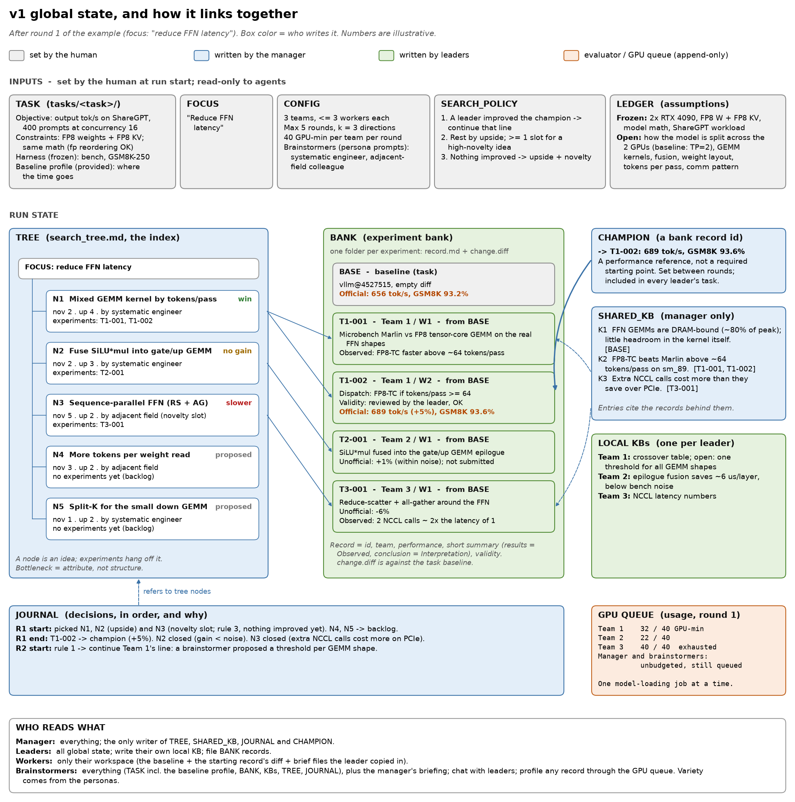
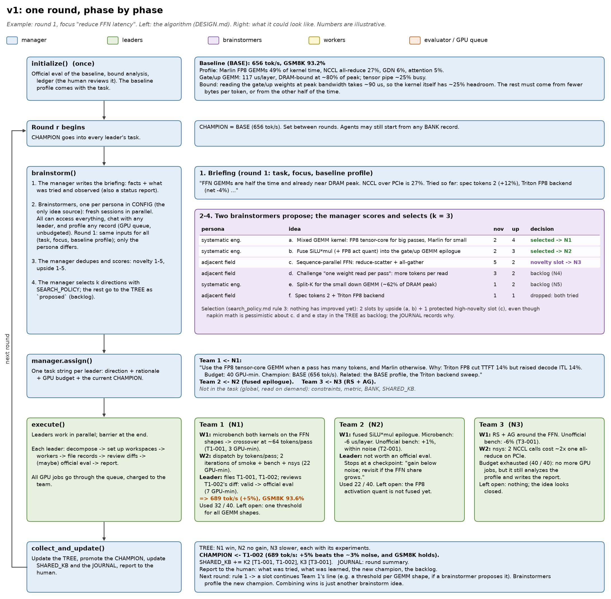
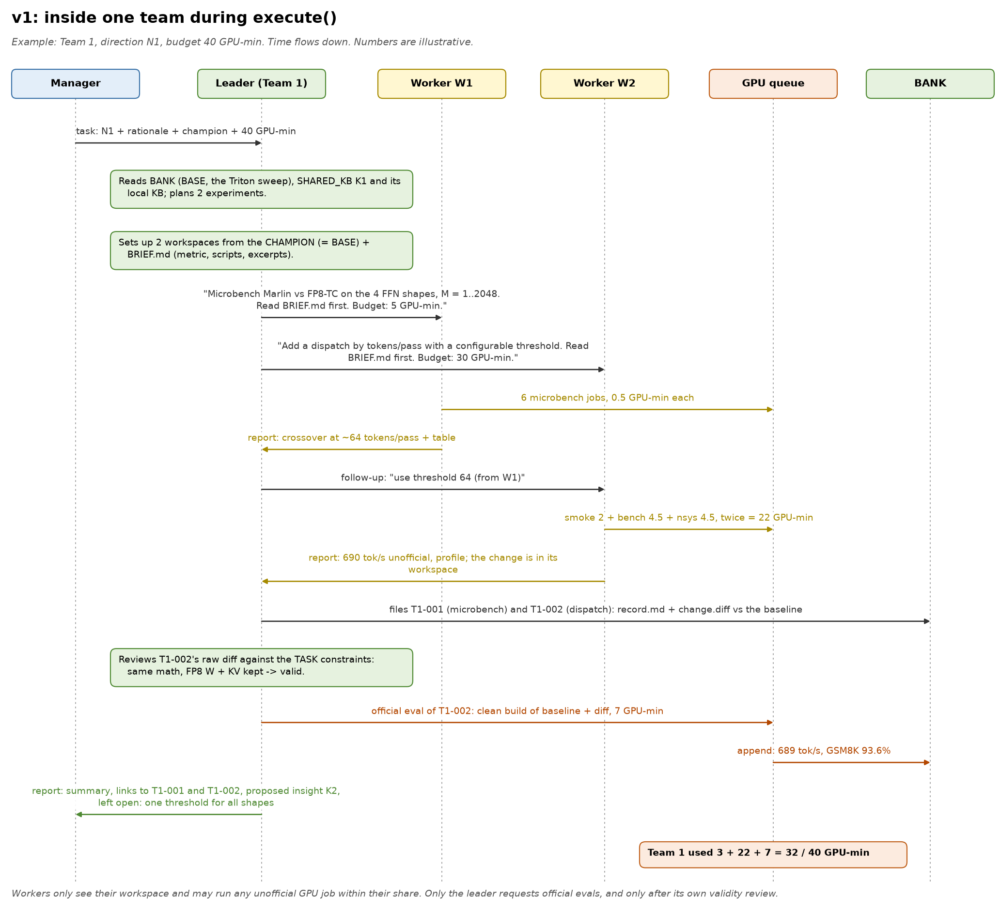

# v1: an example round, visually

A made-up round 1 on the qwen task (Qwen3.8-27B-FP8 on 2x RTX 4090; the baseline uses TP=2) with the focus **"reduce
FFN latency"**. The profile facts come from `qwen38_opt` (Marlin FP8 GEMMs ~49% of kernel time,
DRAM-bound at ~80% of peak; NCCL all-reduce ~27%); every result after the baseline is
**illustrative**, not measured. Regenerate the images with `diagrams/make_diagrams.py`.

## 1. Global state and how it links together
What exists after round 1, who writes each piece, and the pointers between them: tree nodes → bank
records, CHAMPION → a bank record, shared-KB entries → the records they cite, journal → tree nodes.

## 2. One round, phase by phase
The algorithm in `DESIGN.md` on the left, what each phase produces in the example on the right:
initialize → snapshot champion → brainstorm (briefing, brainstormers, scoring, selection)
→ assign → execute (3 teams in parallel) → collect and update → next round.

## 3. Inside one team
Team 1 during `execute()`: the leader plans, sets up workspaces, gives tasks and follow-ups to two
workers, files records, reviews validity, requests the official eval, and reports. GPU work goes
through the queue and is charged to the team's 40 GPU-minute budget.

